<h1 align="center">
  
</h1>

<p align="center"><strong>One plugin list for all your coding agents</strong></p>

<p align="center">Harness manager · Plugin sync · Plugin updater · Skill harmonizer</p>

<p align="center">
  <a href="#what-muro-does">Features</a> ·
  <a href="#install">Install</a> ·
  <a href="#usage-examples">Usage</a> ·
  <a href="#marionette-muro-as-a-harmonizer">Marionette</a> ·
  <a href="#supported-harnesses">Harnesses</a> ·
  <a href="#build-your-own-package">Build a package</a> ·
  <a href="#contributing">Contributing</a>
</p>

---

Muro is a Windows desktop app that looks after the coding agents on your computer: Claude Code, Codex, OpenCode, Pi and Hermes Agent. You keep one list of the plugins you want and the harnesses each one goes on. Muro installs them, removes what you no longer want and keeps everything up to date. When a plugin has no build for one of your harnesses, Muro can rebuild it for that harness with AI.

The same engine is a harmonizer. Muro's factory absorbs pinned skills and plugins from several sources into one package with its own catalog, coordinator and release for every harness. [Marionette](#marionette-muro-as-a-harmonizer) is the package this repository builds as an example.

<picture>
  <source media="(prefers-color-scheme: dark)" srcset="docs/assets/screenshots/sync-changes-dark.png">
  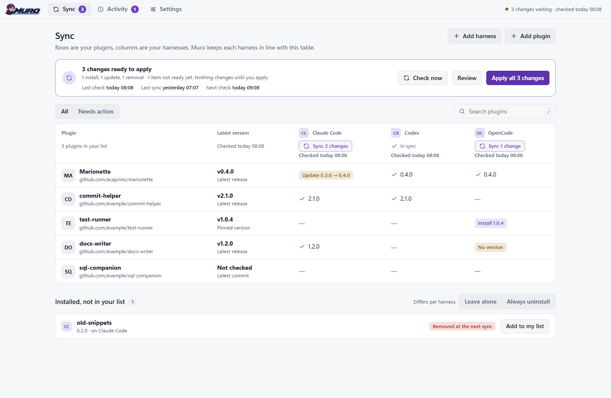
</picture>

<sub>Screenshots use demo data. This one follows your GitHub theme: Muro has a dark and a light theme.</sub>

## What Muro does

Muro is one window with four tabs: **Projects**, **Sync**, **Activity** and **Settings**.

### Projects

A project is one `.mp` file that holds a unified plugin and everything behind it: the plugins and skills it absorbs, at their pinned commits with their licenses, the choices made and why, the history and the prompts. Muro ships with one, Marionette, and **Open project file…** adds yours. A project page has four steps: **Inputs** (what goes in, pinned to what, and what each part became), **Harmonize** (the decision records, the choices by part, the history of runs and the prompts, read only for now), **Graph & simulator** and **Install** (a switch for each harness, applied from Sync like any other change). The simulator shows which branch of the plugin's decision graph a request activates, and in what order: a documented example runs no AI, and a request you type is classified by the AI through a coding agent on your computer (Claude Code or Codex) or an OpenAI-compatible API, as **Settings → AI** says, and the page tells you what it may cost before the first one. See [Projects in the desktop guide](docs/desktop.md#projects).

### Harness manager

Muro finds the coding agents installed on this computer and manages the ones you pick, in the first run or later with **Add harness**. A harness is a column of the Sync table. For each one Muro knows where its plugin configuration lives, which program runs it and what is installed.

- **Add harness** lists every agent detected through [Mukade](https://github.com/acaprino/mukade) and also takes one by hand.
- A column header opens the harness's sheet: its configuration folder and executable, **Keep this harness in sync** (off pauses it), the rule for plugins outside your list on this harness, and **Installed here**, which shows plugins outside your list too; **Add to my list** imports one. **Stop managing** removes the column and leaves the plugins installed.

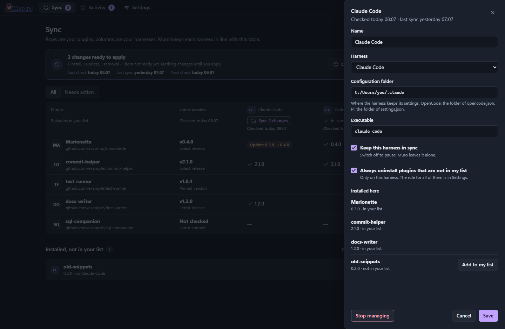

### Plugin sync

Your list says which plugin goes on which harness. The strip at the top of **Sync** is the state of all of it, and it is always visible: when it was last checked, when it was last synced, and how many changes are waiting. **Check now** compares the list with what is actually installed and lists every change (install, update, remove) with its reason, before anything happens.

- Nothing changes until you press **Apply all N changes**. Muro first checks that your list, the inventories and the prepared builds are still the ones it compared; if they are not, or if something is not ready, it opens **Review** instead.
- A plugin that is not ready (no build for one of its harnesses, or a harness that cannot be read) does not stop the rest: **Review** lists it under **Not ready yet** and applies what is ready. On a harness with such a problem nothing is uninstalled.
- A check right after a sync finds nothing to do.

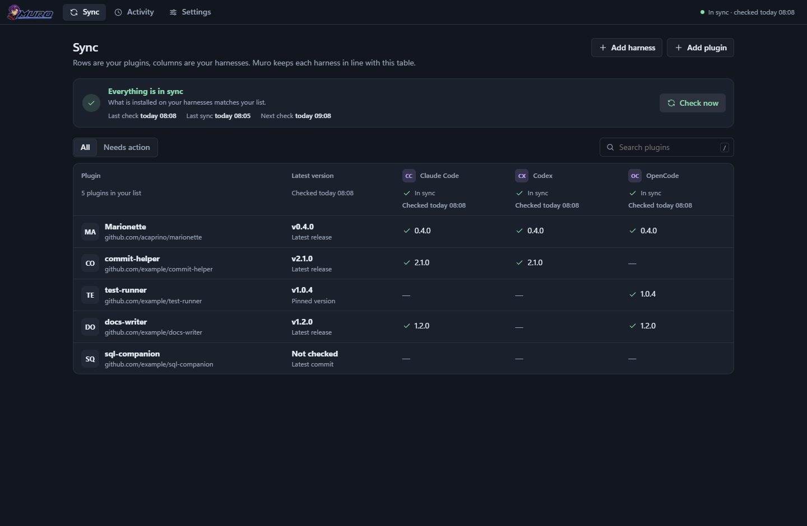

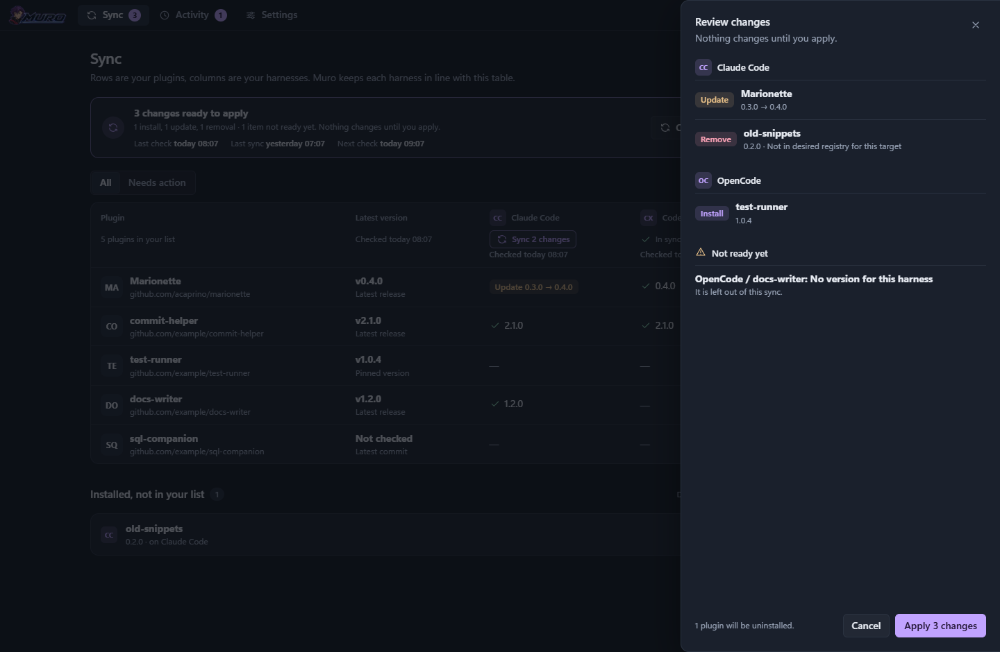

### Background

Muro can stay in the notification area and keep your harnesses in line without a window.

- **Start Muro when Windows starts** (Settings → Background) starts it in the notification area, with no window. Closing the window leaves Muro there unless you turn off **Keep running when the window is closed**; **Quit Muro** in the tray menu ends it, after the sync in progress.
- At start and then at every interval (every hour by default) Muro resolves your plugins' sources, reads every harness and records the result, so the tray icon and the Sync page say how things stand. With **Automatic sync** on it also applies what is ready, except removals: it never uninstalls, and says how many removals wait for your confirmation; with it off it only checks, and the tray says how many changes are waiting.
- The tray menu has **Open Muro**, **Sync now**, **Pause automatic sync** and **Quit Muro**.
- **Activity** lists what Muro did, newest first, with the adaptations that are running, and filters for Sync, AI adaptation and Problems.

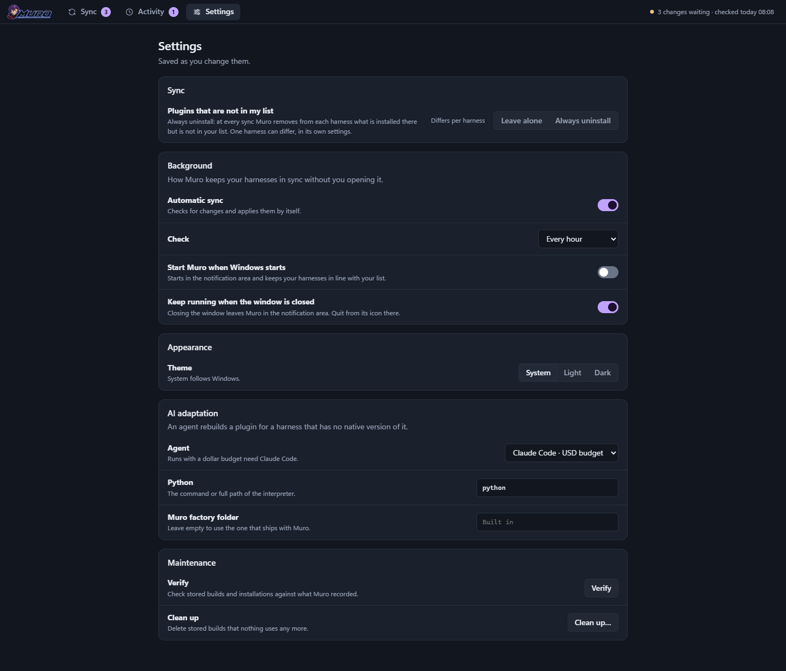

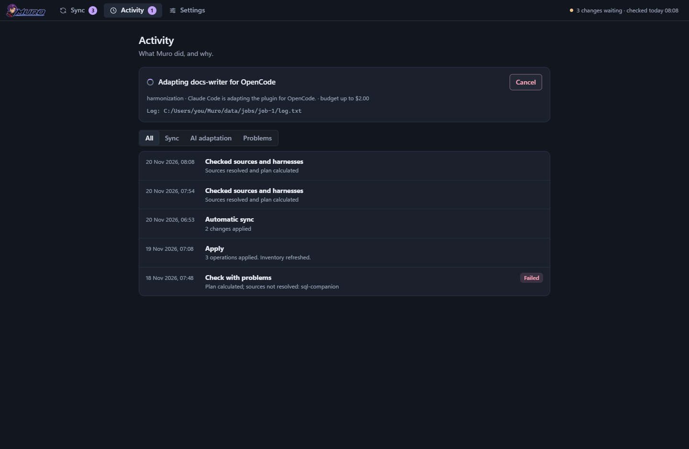

### Plugin updater

Every plugin follows an update policy: latest stable release, a pinned version or the latest commit. **Check now** reads every plugin's source, records the upstream version and revision, and takes the native build the source publishes for each harness; **Check for updates** in a plugin's dialog does the same for that one plugin. Sync then installs the new version.

- The *Latest version* column shows what the source offers, and each harness cell shows what is installed there, or the change that is waiting, such as **Update 0.3.0 → 0.4.0**.
- **Plan a reinstall**, under **More** in a plugin's dialog, puts back the last verified build, not whatever the source holds today.
- **Settings → Maintenance** verifies the stored builds and deletes the ones nothing uses.

### AI adaptation

A plugin with no build for one of its harnesses shows **Needs a build** in that cell. **Adapt with AI**, under **More** in the plugin's dialog, has Claude Code rebuild it for that harness with Muro's factory, and the factory validates the result before Muro records it. You set a maximum budget in dollars; Claude Code checks it between turns. Your own Markdown instructions for the plugin go in with the source. Sync installs the new build like any other.

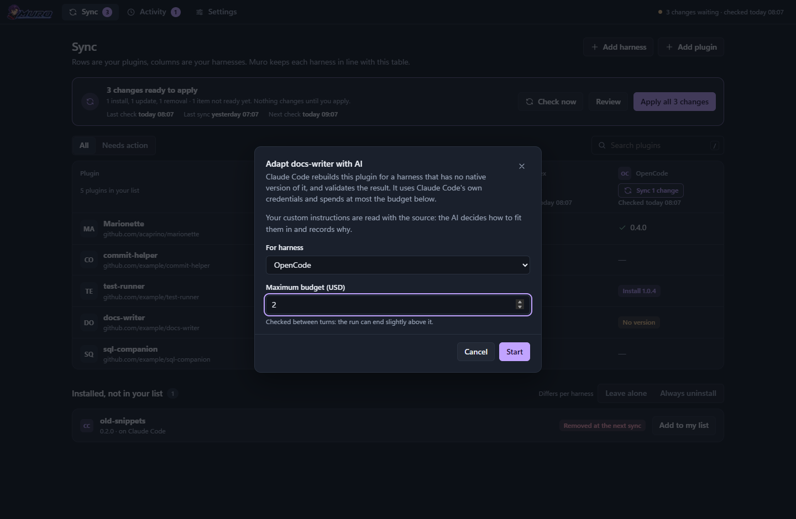

### Theme

Muro has one look, with a dark and a light theme that follow your system. **Settings → Appearance** sets System, Light or Dark, and Muro remembers it.

## Install

Download Muro from the [releases](https://github.com/acaprino/muro/releases), tagged `muro-v<version>`:

- `Muro-<version>-setup.exe` installs Muro.
- `Muro-<version>-windows-x64.zip` is the portable folder: unzip it and open `Muro.exe`. Your list stays in `data/` beside it, so move the whole folder, not just the program.

Muro runs on Windows with the WebView2 runtime. It brings its own Git, curl, Python and factory. The coding agents and their accounts are yours: Muro installs none of them. Opening the app installs no plugin either; only a sync you apply does, or automatic sync once you turn it on.

To build Muro from source, see [desktop setup](docs/desktop.md#run-from-source).

## First steps

The first time Muro opens, and until it manages a harness, three steps take the place of the tabs.

1. **Pick the agents Muro manages.** Muro lists the coding agents it found, with the folder where each keeps its plugin configuration (for OpenCode the folder of `opencode.json`, for Pi the folder of `settings.json`). Nothing is ticked for you.

   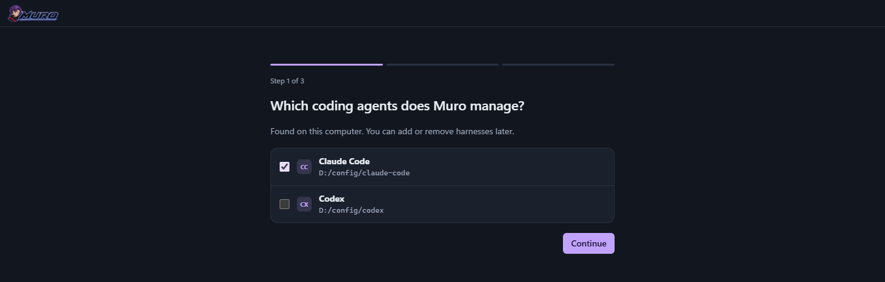

2. **Keep what is installed.** The plugins already on those harnesses become your list; untick the ones you do not want.

   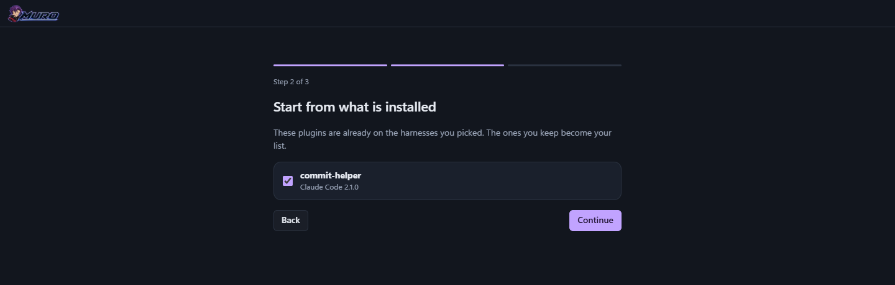

3. **Keep them in sync by itself?** Two switches: automatic sync, and start with Windows. Both are offered on; turn off what you do not want, then **Finish**.

   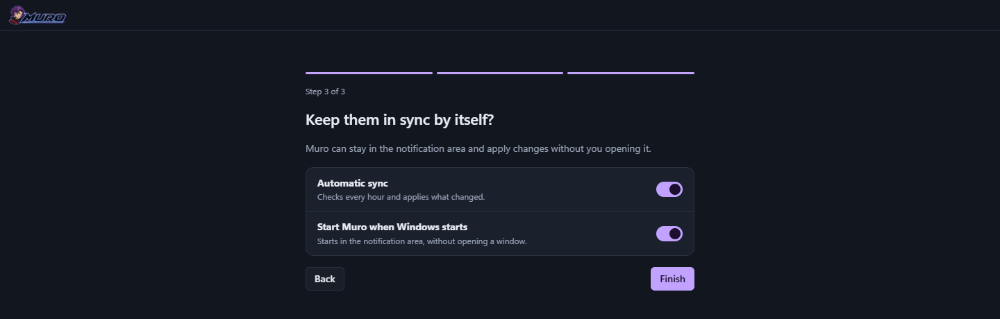

Then, on **Sync**, **Add plugin**: give its source (a repository, or a folder on this computer) and tick the harnesses it goes on. Muro finds each harness's plugin where that harness looks for it (its manifest or its marketplace at the root, or `adapters/<harness>` in a Muro build), and a Muro build published in a folder of its repository is found from the repository's address alone, as in `https://github.com/acaprino/marionette`; for any other plugin in a folder of its repository, add `#folder` to the address. Press **Check now**, read the strip, and press **Apply all**.

## Usage examples

### One plugin on every harness

1. **Add plugin**, give its source, tick Claude Code, Codex and OpenCode under **Install on**, then **Add plugin**.
2. **Check now**: Muro records the upstream version and the native build for each harness.
3. Read the strip, then **Apply all**.

### Keep everything up to date

- **Check now** looks for a newer version of every plugin under its update policy. The **Needs action** filter shows the plugins with a change waiting, and **Review** lists every update before **Apply all** installs them.
- Or turn on **Settings → Background → Automatic sync** and choose how often it runs. Each run checks every plugin for updates and applies the changes.

### A plugin on a harness it was not made for

In the demo, `docs-writer` has a build for Claude Code only. Ticked for OpenCode too, its OpenCode cell shows **Needs a build**.

1. Open the plugin, then **More → Adapt with AI**. The harness without a build is preselected; set the maximum budget.
2. Follow the job in **Activity**. When it succeeds, the cell shows the new version.
3. **Apply all** installs it.

Adaptation runs the coding agent chosen under **Settings → AI** (today it needs Claude Code for its budget), on your computer with its own credentials, and has a real inference cost. The budget the dialog starts from is the one in Settings.

### Remove what you did not choose

Under **Installed, not in your list**, or in **Settings → Sync**, choose **Uninstall, asking first**: Muro plans the removal of what is installed on a harness but is not in your list. A harness can differ in its own sheet. The next check lists the removals, each marked *Removal waits for your confirmation*; nothing is uninstalled until you confirm in the review sheet, whose button says how many plugins it uninstalls (**Apply without uninstalling** applies the rest), and automatic sync never uninstalls. To keep one of those plugins, press **Add to my list** beside it.

### Your own instructions for a plugin

Open the plugin, then **More → Open instructions folder**, and write Markdown notes there. Press **Reload files** under **Custom instructions**, then **More → Adapt with AI** again for each harness listed under *Instructions changed*. The AI decides whether each note becomes session guidance, a capability or a hook, and records why. See [custom instructions](docs/custom-instructions.md).

### From the command line

Everything the app does is a request to `muroctl`, in the `tools` folder of the portable app:

```powershell
.\tools\muroctl.exe request snapshot     # your list, what is installed, the activity
.\tools\muroctl.exe request scan         # read the plugins of every harness again
.\tools\muroctl.exe request check        # resolve the sources, then the changes a sync would make
.\tools\muroctl.exe request plan         # the changes a sync would make, without resolving the sources
.\tools\muroctl.exe request apply --input .\apply.json   # {"plan_id": "<the id plan returned>"}
.\tools\mukade.exe harnesses             # the coding agents found on this computer
```

[Desktop CLI reference](docs/desktop-cli.md) · [Example requests](examples/desktop/README.md) · [The desktop app in detail](docs/desktop.md) · [Design record](docs/adr/ADR-0023-global-desktop-registry.md)

### Marionette: Muro as a harmonizer

Marionette is an example of how Muro works as a harmonizer. The factory absorbed 16 pinned sources, skills and plugins for web and product design, motion, Office files, explainers, research papers, engineering method and prose, into **one package**: 37 capabilities, one coordinator and a release for every supported harness. Overlapping skills were merged and their conflicts resolved, and each capability states what it produces and which checks prove it. At run time the host AI classifies each request by meaning, Python validates the plan, and the steps run one capability at a time, each handing its outputs to the next. Marionette stands in for the 63 skills it absorbed: they are not installed beside it.

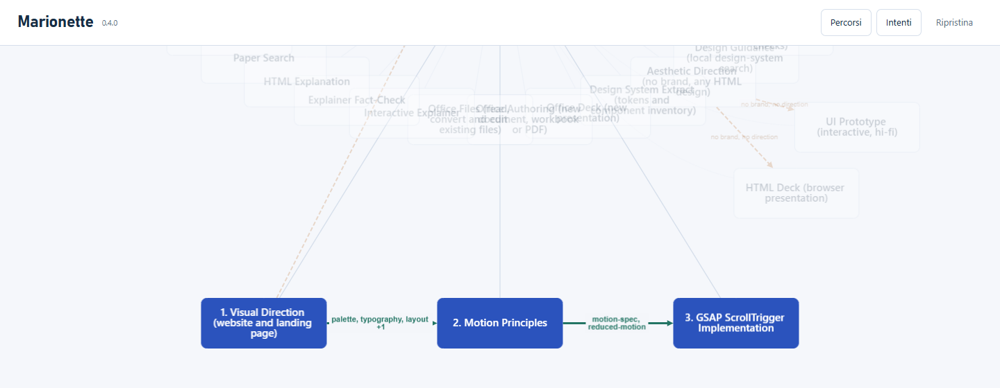

<sub>`GUIDE.html`, the offline guide in every Marionette release, with one example path selected.</sub>

| You ask | Marionette runs |
| --- | --- |
| Design a new landing page, define its scroll animations and implement them in our GSAP project | Visual direction → Motion principles → GSAP ScrollTrigger |
| Design our new product's landing page in Figma; we have no content outline yet | Visual direction → Canvas design |
| Convert this Word document to PDF without changing its content | Office files |
| A clickable prototype of our new app's onboarding, with no brand yet, checked before delivery | Aesthetic direction → UI prototype → Design review |
| Find the original paper on a method and explain it so that I really understand it | Paper search → HTML explanation |
| Review only my uncommitted changes, without editing files | Engineering review |
| My idea for a shared rate limiter: a brief, the design document, then the plan and its execution | Concept brief → Design document → Implementation plan → Plan execution |
| Make this email to a client sound natural, adding nothing | Text humanize |

These are 8 of the 26 [reviewed examples](examples/marionette/guide-examples.json) the guide shows. Marionette also carries a session policy made from **[Ponytail v5.3.3](https://github.com/DietrichGebert/ponytail/tree/v5.3.3)** and **[i-have-adhd v0.4.1](https://github.com/ayghri/i-have-adhd/tree/v0.4.1)**, plus [one instruction of its owner](examples/marionette/custom-instructions/recap-adhd.md): complete, focused work and replies that are easy to act on. The complete adapter loads it through the host's system or developer channel, before any skill is chosen. A code-change review, a whole-repository audit, a ledger of deliberate shortcuts and an explanation of the working method stay separate tasks you can ask for. See the [integration record](docs/verification/2026-11-12-marionette-ponytail-adhd.md).

**Install it.** Download `marionette-<version>.zip` and its `.sha256` from the [releases](https://github.com/acaprino/marionette/releases) of its own repository, tagged `marionette-v<version>` (0.2.0 to 0.4.0 are among [Muro's releases](https://github.com/acaprino/muro/releases)). Unzip it and follow `INSTALL.md` in the adapter folder of your harness. For Claude Code:

```sh
claude plugin marketplace add <unzipped folder>/marionette/adapters/claude-code
claude plugin install marionette@marionette
```

Then ask in plain words, or run `/marionette:marionette`. To build Marionette from this checkout, see [Build your own package](#build-your-own-package).

[Browse the catalog](examples/marionette/ROUTER.md) · [Read the capabilities](examples/marionette/capabilities/) · [See the source manifest](examples/marionette/sources.json) · [Delivery decisions](examples/marionette/delivery.json)

## Supported harnesses

| Harness | Desktop app | Package adapter | Native session instructions | Declared source command hooks |
| --- | --- | --- | --- | --- |
|  **[Claude Code](https://code.claude.com/docs/en/plugins/mods/reference)** | Yes | `adapters/claude-code/` | `prompt.compose` system section | Supported |
|  **[Codex](https://developers.openai.com/codex/hooks/)** | Yes | `adapters/codex/` | Developer context on session and subagent start | Supported |
|  **[OpenCode](https://opencode.ai/)** | Yes | `adapters/opencode/` | System parts via the V2 package plugin API | — |
|  **[Pi](https://pi.dev/)** | Yes | `adapters/pi/` | Named system section via a package extension | — |
|  **[Hermes Agent](https://github.com/NousResearch/hermes-agent)** | Yes | `adapters/hermes/` | Registered system prompt section up to 4,000 characters; a longer policy goes whole through `pre_llm_call` | — |

The desktop app also finds DeepSeek, which has no plugin adapter yet. Each package adapter is a native adapter in the generated release; its `INSTALL.md` covers the host API, installation and activation limits.

Installing the **complete adapter** lets the harness load the session instructions and active hooks declared in `delivery.json`, subject to the host's permissions and trust settings. For on-demand capabilities, the standalone `skills/<command>/` directory includes its launcher, catalog, prompts, helpers, notices and offline guide. Keep the directory intact and install any discovery entries alongside it.

Each adapter's `INSTALL.md` ends with the host's own install command. The Claude Code and Codex adapters are their own marketplace (`claude plugin marketplace add <adapter>`, `codex plugin marketplace add <adapter>`); Pi uses `pi install <adapter>`; OpenCode lists the adapter under `plugins` in `opencode.json`. On Claude Code, Pi and OpenCode the declared session instructions are active with no further step. Codex runs a plugin's hooks only after you trust them once in `/hooks`. See the [live activation runs](docs/verification/2026-11-12-policy-active-by-default-live.md).

Marionette completed a two-step workflow in live runs on **Claude Code, Codex, OpenCode, and Pi**. Hermes prompt registration was exercised through its real plugin API. See the [live harness runs](docs/verification/2026-11-12-all-hosts-live.md) and the [native policy checks](docs/verification/2026-11-12-native-policy-delivery.md) for the scope of each test.

[Harness logo sources](docs/assets/branding/harnesses/README.md)

## How the harmonizer works

| Phase | What happens |
| --- | --- |
| **Intake** | Muro exports the verified source selection. The host AI reads it, extracts supported intents, constraints and tools, and records what each part should become. |
| **Harmonization** | The host AI resolves overlaps and conflicts, defines variants and dependencies, and reviews delivery decisions across the whole package. |
| **Build** | Muro verifies pins, licenses, the catalog and examples, then packages the runtime, host adapters, notices and offline guide. |
| **Runtime** | The host AI interprets the request and chooses capability and intent pairs. Python validates that decision against the task, stack and catalog, expands declared prerequisites, and hands off one capability at a time. |

Intake sets the package scope. The host AI owns the meaning of intents and judges whether a conditional prerequisite applies. Output handoffs describe data flow independently of prerequisites. A package can expose **on-demand capabilities**, supply **session instructions**, or register **declared hooks**. The host AI records why each delivery form fits, and Muro emits the validated declarations. A package can also ship session policy alone with a header-only router and reviewed `no_match` guide examples.

[AI-owned routing](docs/adr/ADR-0003-ai-owned-intent-classification.md) · [Data flow and prerequisites](docs/adr/ADR-0012-data-flow-and-conditional-prerequisites.md) · [Delivery contract](docs/adr/ADR-0016-delivery-form-and-self-registering-releases.md)

<details>
<summary>Runtime protocol and evidence</summary>

1. `plan --task "..." --project <path>` returns the classification context. The host AI copies `task`, `stack_tokens`, and `catalog_digest` into the decision and authors `status`, `selections`, `reason`, and `questions`, plus any declared `needs` judgments. Repeated capabilities can carry a distinct `step_id` such as `office-files#1`.
2. The host writes its JSON in the state folder and passes it to the same `plan` call with `--classification <file>`. Use `--brief` for the index and `--compact --focus <ids>` to read selected capabilities in full. `direct` returns one step, `confirm` returns an ordered plan to approve with `--confirm`, and `no_match` or `needs_clarification` stops execution.
3. Submit outputs and checks with the returned `step --project <path> --map-id <id> --capability <step> --step-data <file>` arguments. A step answers only the checks its result lists: those its capability declares for the intent chosen for that step (`intent_checks`). A check recorded on the wrong step is rejected, and `not-applicable` is accepted only for a check with a declared condition (`check_conditions`, [ADR-0018](docs/adr/ADR-0018-checks-scoped-to-the-step-intent.md)). The runtime also accepts separate `record`, `check`, and `complete` calls. The coordinator holds a tokened writer lock during state changes. Use `unlock --token <token>` to recover after a crash.
4. Use `resume --project <path>` to continue the saved decision. When the user changes the request, classify it again and use `plan --amend`. By default the steps run again. The host may pass `--preserve-completed <steps>` for work it has checked against the revised request. For example, a change to a site's animation can reuse an approved page outline, while a change to its audience and offer requires a new outline. Confirmation archives the previous map. Use `--new` to start a separate task.

Capabilities hand outputs over through their `## Output handoff` sections using the step's recorded outputs and state directory. The coordinator owns the map, and helpers resolve under the package root. `python muro.py session-context` prints the declared policy for inspection. Policy changes invalidate earlier decisions through the catalog digest.

[Classification prompt](prompts/classify.md) · [Output ownership and writer lock](docs/adr/ADR-0004-output-owners-conflicts-and-map-writer-lock.md) · [Runtime lifecycle](docs/adr/ADR-0013-runtime-lifecycle-discovery-and-factory-isolation.md)

</details>

## Build your own package

The factory needs **Python 3.10+** and **Git**. Building verifies the pinned sources, so it needs network access. From the repository root, build Marionette:

```sh
python muro_build.py --manifest examples/marionette/sources.json --validate
python muro_build.py --manifest examples/marionette/sources.json --build
```

The release lands in `examples/marionette/dist/marionette/`; when a build is already there, pass `--out <fresh-directory>`. Open its `GUIDE.html` and choose an example under **Percorsi** (Paths), or load it in Claude Code for one session:

```sh
claude --plugin-dir examples/marionette/dist/marionette/adapters/claude-code
```

Run `/marionette:marionette` and ask *“Explain how this repository builds a release as interactive HTML.”* For another host, open the `INSTALL.md` in its adapter directory.

<details>
<summary>Inspect what the harness receives</summary>

```sh
python examples/marionette/dist/marionette/muro.py plan --task "Explain how this repository builds a release as interactive HTML" --project .
```

`classification-required` returns the task context, catalog, and instructions the host AI uses to choose a route. With a valid selection, the launcher returns either a single step or a plan to confirm.

</details>

### The factory command line

The same operations are subcommands of one CLI: `python -m muro validate --manifest examples/marionette/sources.json`, or install the `muro` command with `pip install -e .` from this checkout (editable; the factory's prompts sit beside the package). `muro --help` lists every command, including two the flag interface does not have: `review` prepares a host-AI re-examination of the package's recorded decisions against its pinned sources, and `baseline` reports, read-only, which source pins are behind their upstream ([ADR-0021](docs/adr/ADR-0021-factory-cli-executable.md)).

The factory can also run its AI-owned steps itself ([ADR-0022](docs/adr/ADR-0022-agentic-cli-mcp-and-absorb.md)): `muro mcp` serves the operations to an MCP host (add it to Claude Code or Codex and the host AI drives intake, harmonization and review through its own tools), `muro agent` runs the same steps through an OpenAI-compatible endpoint (API key from an environment variable, never an argument), and `muro absorb <repo-url> <dir> --harness <h> --home <path>` takes one skill from a repository link to an installed plugin in one command: scaffold (`muro init`), intake, harmonization, build, then `muro install`, which executes the built adapter's own INSTALL.md against the harness home you name.

The full command reference, with every command, parameter, exit code and worked example, is [docs/cli.md](docs/cli.md).

### A package of your own

Start with Marionette's layout and give the new package its own identity and source selection. Each package can supply its own prompts or runtime, with Muro's factory defaults available out of the box.

| File | What it holds |
| --- | --- |
| `sources.json` | Package identity, source pins, licenses, selected paths, exclusions, runtime dependency notes, and intake goals. Optional `intake_only_paths` name selected files the generated plugin does not need at run time: they are read at intake and not shipped in the release. `omissions` (`{paths, reason}`) explain each file the selected files name and the plugin does not need; `media_paths` declare the images, fonts and other binary files that travel ([ADR-0026](docs/adr/ADR-0026-source-coverage-evidence-at-intake.md), [ADR-0027](docs/adr/ADR-0027-declared-binary-media.md)) |
| `capabilities/*.md` | Intents and exclusions, procedures, outputs, checks, tools, hooks, and relationships. With more than one intent, `intent_checks` says which checks each intent answers; `check_conditions` gives the case in which a conditional check applies ([ADR-0018](docs/adr/ADR-0018-checks-scoped-to-the-step-intent.md)) |
| `ROUTER.md` | Catalog index with one row per capability and the harmonization record |
| `guide-examples.json` | Reviewed requests with explicit decisions that the guide validates and illustrates |
| `entries.json` | Optional discovery skills that point into the same catalog. Each entry's `absorbs` names the originals from `plugin.replaces` it stands in for, written into its description by the build ([ADR-0019](docs/adr/ADR-0019-absorbed-originals-named-at-discovery.md)) |
| `delivery.json` | Optional delivery decisions, session text, and hook declarations |
| `custom-instructions/**/*.md` | Your own instructions in free Markdown; the host AI decides their form and scope during harmonization |
| `eval-cases.json` | Optional routing examples. Each case names the expected status and ordered capabilities. Add `expect.selections` to score intents, repeated steps and conditional prerequisites. Use `alternatives` for additional complete routes the request allows. |

1. **Prepare intake.** Run `muro intake <source-id>` with the new manifest. Give the host AI the prompt and evidence under `.muro/factory/intake/<source-id>/` beside the manifest. The evidence includes `coverage.json`: what the source holds outside your selection and which of it the selected files name, so the AI can complete `selected_paths` before it writes a capability ([ADR-0026](docs/adr/ADR-0026-source-coverage-evidence-at-intake.md)).
2. **Harmonize.** Run `muro harmonize` and give the host AI the context under `.muro/factory/harmonization/`. Review the resulting catalog, rationale, and examples.
3. **Verify and build.** Run `muro validate`, `muro check-sources`, and `muro build` separately with `--manifest <path-to-sources.json>` each time. The release lands in `dist/<slug>/` beside the manifest unless you supply `--out`.
4. **Keep it honest over time.** `muro baseline` says which pins fell behind their upstream (exit 1 when one did), and `muro review` prepares the host-AI re-examination of the recorded decisions before you re-pin or re-harmonize. Both change nothing by themselves.

Every step also works through the legacy flags (`python muro_build.py --manifest … --validate`).

[Intake prompt](prompts/intake.md) · [Harmonizer prompt](prompts/harmonizer.md) · [Delivery prompt](prompts/delivery.md) · [Review prompt](prompts/review.md) · [Factory and package boundary](docs/adr/ADR-0011-factory-separate-from-its-packages.md)

### Add your own instructions

Create `custom-instructions/` beside your package's `sources.json` and add any
UTF-8 `.md` files, including subfolders. No frontmatter or special filenames are
required. For example, Marionette's [recap-adhd.md](examples/marionette/custom-instructions/recap-adhd.md)
asks for short progress updates while waiting, making important changes or
deciding autonomously.

1. Write or edit your Markdown files.
2. Prepare the AI handoff: `python muro_build.py --manifest examples/marionette/sources.json --harmonize`.
3. Ask your host AI to read `.muro/factory/harmonization/PROMPT.md` beside that manifest and apply its resulting delivery/catalog changes to the package. The preparation includes an exact snapshot of your Markdown. **The command prepares evidence; the host LLM performs the harmonization.**
4. Validate and build into a fresh directory using the commands below, then install the resulting complete adapter following its `INSTALL.md`.

```sh
python muro_build.py --manifest examples/marionette/sources.json --validate
python muro_build.py --manifest examples/marionette/sources.json --check-sources
python muro_build.py --manifest examples/marionette/sources.json --build --out .scratch/custom-instructions-release
```

The AI chooses whether each part becomes permanent system/developer guidance,
an on-demand capability or a supported hook, and records its reasons and any
coexistence changes. Filenames and ordering never decide precedence. Adding,
editing, renaming or removing files requires another harmonization; validation
refuses delivery tied to older inputs. Original files stay untouched in your
source package. A release carries only originals that its runtime needs.

See the [complete user guide](docs/custom-instructions.md) for the desktop path,
removal, verification and delivery metadata, and
[ADR-0024](docs/adr/ADR-0024-custom-instructions-markdown.md) for the decision. Marionette's recap rule is session
policy, so it needs the complete native adapter; invoking a skill alone does not
activate permanent instructions.

<details>
<summary>Source pins, licenses, and runtime dependencies</summary>

Each source records a full commit SHA. `pin: release` ties it to a published tag, `pin: head` follows an upstream without releases or tags, and `pin: static` freezes a reviewed commit. Re-pinning calls for a review of the selected paths and license notices.

The source gate accepts MIT and Apache-2.0, checks selected paths for nested licenses and SPDX conflicts, and ships applicable licenses and notices. A declared `license_path` covers its own subtree. A source that bundles third-party code in a prebuilt file declares the file listing those notices in `notice_paths`; it ships with the source and the aggregated notice points at it. Images, fonts and other binary files are refused unless the source declares them in `media_paths`, which the intake does after reading how the source licenses them; the gate does not read those rights. A file that the selected files name must be selected or explained in `omissions`, or the check and the build fail.

Upstream code stays inert during intake and build. If a selected capability needs a missing runtime tool, the host checks permissions, reports the official source and install location, uses the narrowest workable scope, and verifies the tool before continuing. Active hooks must have an explicit delivery declaration. Hook commands use literal argv, and Windows batch shims require declaring the executable and script directly.

[Pin policy](docs/adr/ADR-0009-pin-mode-per-source.md) · [Apache notices](docs/adr/ADR-0005-apache-appendix-notice-in-license-gate.md) · [License scope](docs/adr/ADR-0006-license-file-inside-the-source-folder.md) · [Bundled third-party notices](docs/adr/ADR-0025-declared-third-party-notices.md) · [Runtime dependencies](docs/adr/ADR-0007-capabilities-install-missing-runtime-dependencies.md)

</details>

## Ecosystem

| Project | What it does |
| --- | --- |
| **[Shinatama](https://github.com/acaprino/shinatama)** | Run multiple coding-agent harnesses in tiled terminals from a local-first desktop workspace. |
| **[Mukade](https://github.com/acaprino/mukade)** | Browse, export, and move coding-agent sessions between harnesses with a CLI, terminal UI, and Rust library. Muro uses it to find harnesses. |

## Contributing

See [AGENTS.md](AGENTS.md) for repository conventions. [Architecture decisions](docs/adr/README.md), the [functional requirements](docs/frd/README.md), and [verification records](docs/verification/) explain how the desktop app, the factory and the adapters fit together.

The full suite runs in GitHub Actions, in the `Tests` workflow, on every push and pull request. Locally, run the tests of what you changed:

```sh
python -m pytest -q tests/test_<area>.py
python muro_build.py --manifest examples/marionette/sources.json --validate
cargo test -p muro-registry -p muro-desktop-runtime
npm test
npx tsc --noEmit
node apps/desktop/tests/browser.mjs
```

The two tests that drive the real executable, `native.mjs` and `native-shell.mjs`, are described in [the desktop app in detail](docs/desktop.md#verification).

For source and packaging changes, also run `--check-sources` and stage a fresh release with `--build --out <fresh-directory>`. Use `--check-sources --offline-pins` to check manifest pins and local repositories offline. For changes to the routing prompt or catalog, use `--prepare-eval` and score the host AI's decisions with `--score-eval <decisions.json>`.

The screenshots in this README come from `node apps/desktop/tests/screenshots.mjs`, which uses demo data; `MURO_GUIDE=<a release's GUIDE.html>` adds Marionette's guide. Every merge of `develop` into `main` publishes a Muro release. When a merge changes Marionette's `plugin.version` on Muro's `main`, GitHub Actions builds the package and opens a release PR. Merging that PR publishes the ZIP and its SHA-256 in [acaprino/marionette](https://github.com/acaprino/marionette).

[Routing verification](docs/verification/2026-11-09-ai-owned-routing.md) · [Guide verification](docs/verification/2026-11-10-release-html-guide.md) · [Routing eval and development principles](docs/adr/ADR-0015-design-principles-from-first-real-use.md)

## License

[Apache-2.0](LICENSE).
